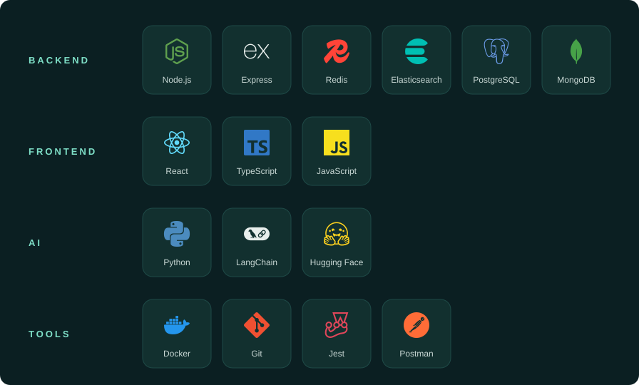

Computer Science Engineering student who builds backend systems and AI-powered applications.

### Skills

### Contact

[LinkedIn](https://linkedin.com/in/rakshitha-c-4965772a1) · Rakshitha.chandrashekar29@gmail.com
